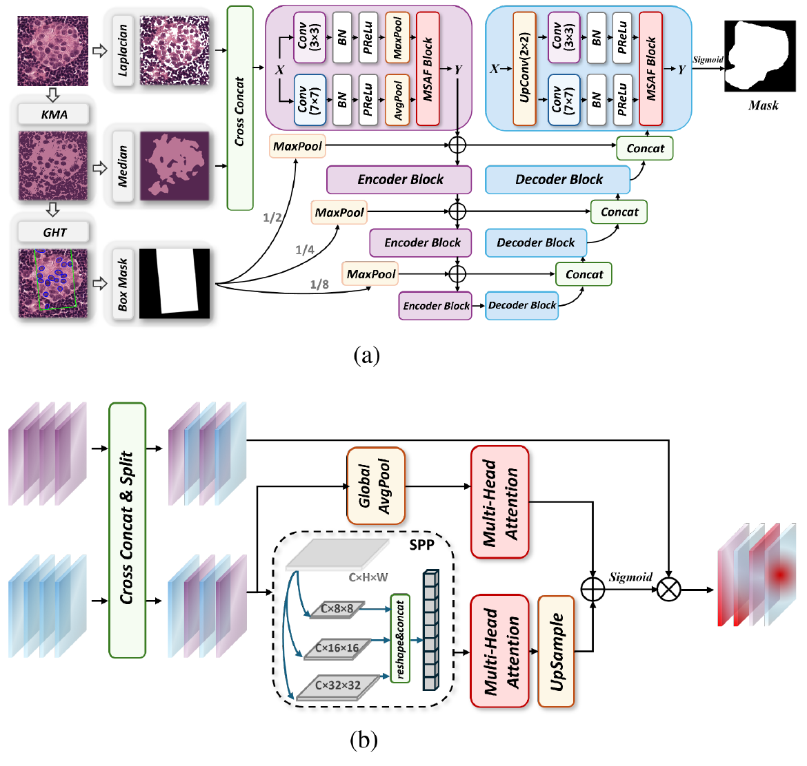
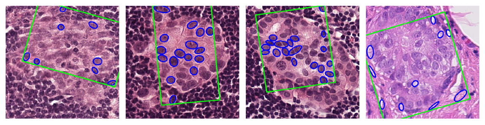
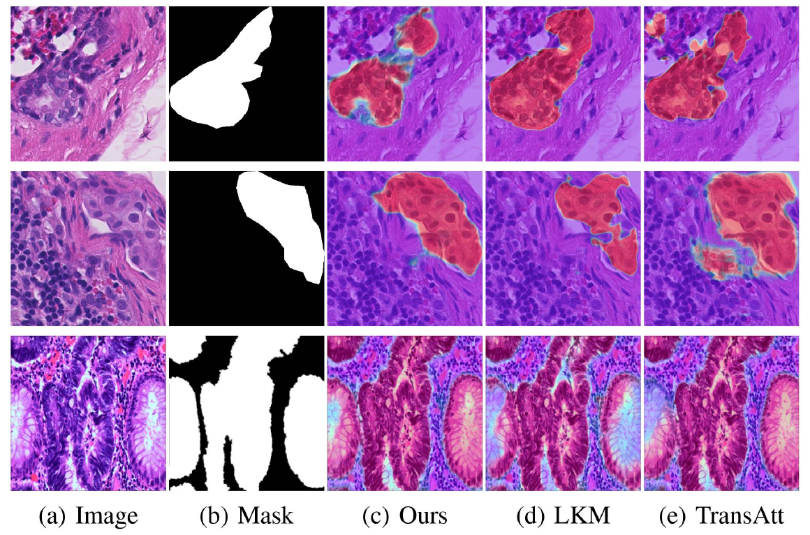
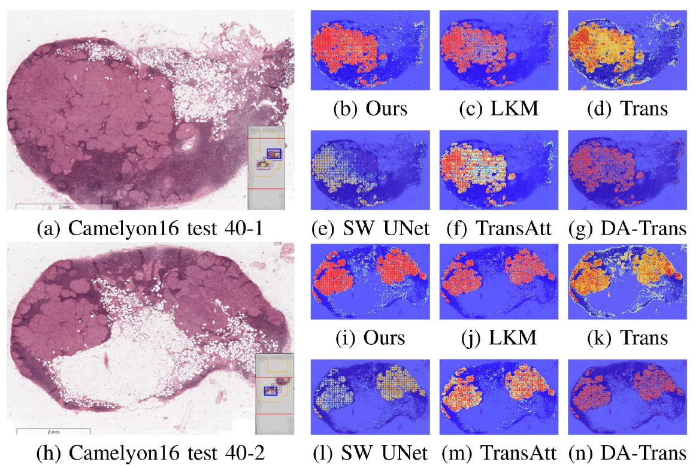
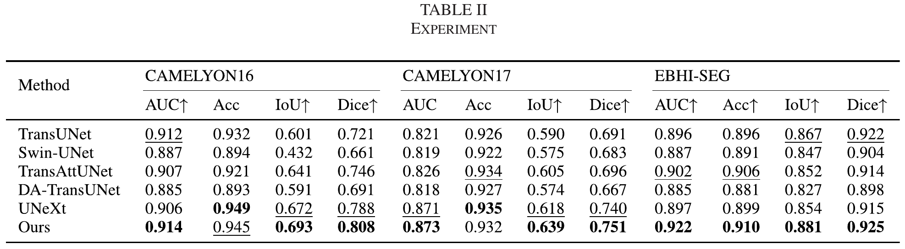
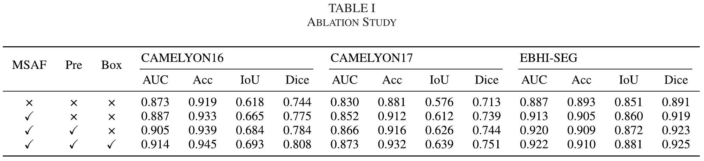

<div align="center">

# MSAF-UNet

### Traditional image processing meets multi-scale attention fusion

**Histopathology segmentation · CAMELYON16/17 · EBHI-Seg**

[Project page](https://kisen7.github.io/UNet-Camelyon/) · [Paper](https://doi.org/10.1109/LSP.2025.3585818) · [中文](README.zh-CN.md) · [Citation](#citation)

Liqi Ye · Junyou Zhang · Jing Wang · Qi Xi · Yandan Yao<br>
*IEEE Signal Processing Letters*, vol. 32, pp. 3415–3419, 2025

</div>

---

**UNet-Camelyon** brings together pathology-image segmentation code and the research presentation for **MSAF-UNet: A Robust Segmentation Method Integrating Traditional Image Processing and Multi-Scale Attention Fusion**.

[Method](#method) · [Published results](#published-results) · [Repository guide](#repository-guide) · [Getting started](#getting-started)

## Method

<p align="center"><a href="docs/assets/paper/architecture.png"></a></p>

*Figure 1 from the paper. Click the figure to view it at full size.*

| Component | Role in the paper |
| --- | --- |
| Texture and color enhancement | Laplacian edges and Otsu thresholding emphasize texture; K-means and median filtering emphasize color structure. |
| Parallel feature extraction | 3 × 3 and 7 × 7 branches capture local detail and wider spatial context. |
| Multi-scale attention fusion | Global attention and local spatial-pyramid features integrate complementary representations. |
| Box prompts | Clustering and the Generalized Hough Transform generate spatial cues for the skip connections. |

<details>
<summary>Box-prompt examples · Figure 2</summary>



</details>

## Published results

Results reported in **Table II, p. 3418** of the paper. EBHI-Seg measurements average the six categories described in the study.

| Dataset | AUC | Accuracy | IoU | Dice |
| --- | ---: | ---: | ---: | ---: |
| CAMELYON16 | 0.914 | 0.945 | 0.693 | **0.808** |
| CAMELYON17 | 0.873 | 0.932 | 0.639 | **0.751** |
| EBHI-Seg | 0.922 | 0.910 | 0.881 | **0.925** |

<p align="center"></p>

*Figure 3. Rows show CAMELYON16, CAMELYON17 and EBHI-Seg. Original image, mask and method labels are retained.*

<details>
<summary>Whole-slide comparison · Figure 4</summary>



</details>

<details>
<summary>Full comparison and ablation tables</summary>





</details>

Figures are cropped directly from the published paper, preserving their colors, labels and values. See [figure sources](docs/assets/paper/SOURCES.md).

## Repository guide

| File or directory | Entry point |
| --- | --- |
| [`UNet.py`](UNet.py) | PyTorch U-Net encoder, decoder and skip connections |
| [`train.py`](train.py) | Training, BCE + Dice loss, validation and checkpoint saving |
| [`pre_WSI.py`](pre_WSI.py) | Sliding-window whole-slide inference and heatmaps |
| [`pre_patches.py`](pre_patches.py) | Patch inference and heatmap overlays |
| [`utils/Gen_SegData.ipynb`](utils/Gen_SegData.ipynb) | Patch and mask preparation from WSI annotations |
| [`utils/read_data.py`](utils/read_data.py) | Paired image/mask loading |
| [`utils/evaluate.py`](utils/evaluate.py) | Segmentation evaluation utilities |
| [`skills/`](skills/) | Batch inference, FP16/JIT options, ONNX export and examples |
| [`modelArch_output/`](modelArch_output/) | Existing architecture notes and editable diagrams |
| [`docs/`](docs/) | Bilingual research page and original paper figures |

## Getting started

```bash
git clone https://github.com/Kisen7/UNet-Camelyon.git
cd UNet-Camelyon
python -m venv .venv
```

Activate `.venv` using `source .venv/bin/activate` on Linux/macOS or `.venv\Scripts\Activate.ps1` in Windows PowerShell, then install dependencies:

```bash
python -m pip install -r requirements.txt
```

WSI reading uses OpenSlide and its native library. Training uses the `segmentation_models_pytorch.utils` API; select a compatible environment for these existing scripts.

### Data and training

Use [`utils/Gen_SegData.ipynb`](utils/Gen_SegData.ipynb) to prepare patches. The loader reads same-named PNG image/mask pairs under `/ho/data/Camelyon16/{train,val}/{img,mask}/`.

The scripts store paths and device choices in source. Review these settings for your machine and data before execution:

| Script | Existing settings |
| --- | --- |
| `train.py` | Batch size 6; 200 epochs; Adam; BCE + Dice; `cuda:1` when CUDA is available, otherwise CPU; saves `UNet_17.pth` |
| `utils/read_data.py` | Dataset root `/ho/data/`; same-named images and masks |
| `pre_WSI.py` | Input `/Camelyon16/test_040.tif`; checkpoint `UNet.pth`; device `cuda:1` |
| `pre_patches.py` | Input `patch_path/`; output `save_path/`; checkpoint `UNet.pth`; device `cuda:2` |

Run training from the repository root:

```bash
python train.py
```

### Batch inference

The existing interface accepts an explicit checkpoint and device. From the repository root, after preparing the checkpoint and a directory of equally sized patches:

```python
from skills.inference_optimized import OptimizedInference

engine = OptimizedInference(
    model_path="UNet_17.pth",
    device="cpu",  # Select the appropriate CUDA device for GPU inference.
    use_fp16=False,
    use_jit=False,
    batch_size=4,
)
engine.process_patches_directory("patch_path/", "output_path/")
```

## Citation

```bibtex
@article{Ye2025MSAFUNet,
  author = {Ye, Liqi and Zhang, Junyou and Wang, Jing and Xi, Qi and Yao, Yandan},
  title = {{MSAF-UNet}: A Robust Segmentation Method Integrating Traditional Image Processing and Multi-Scale Attention Fusion},
  journal = {IEEE Signal Processing Letters},
  year = {2025},
  volume = {32},
  pages = {3415--3419},
  doi = {10.1109/LSP.2025.3585818}
}
```

Source history: [apple2pig/UNet-Camelyon](https://github.com/apple2pig/UNet-Camelyon), currently redirected to `aplish064/UNet-Camelyon`. Original code and research utilities are preserved in this project.
