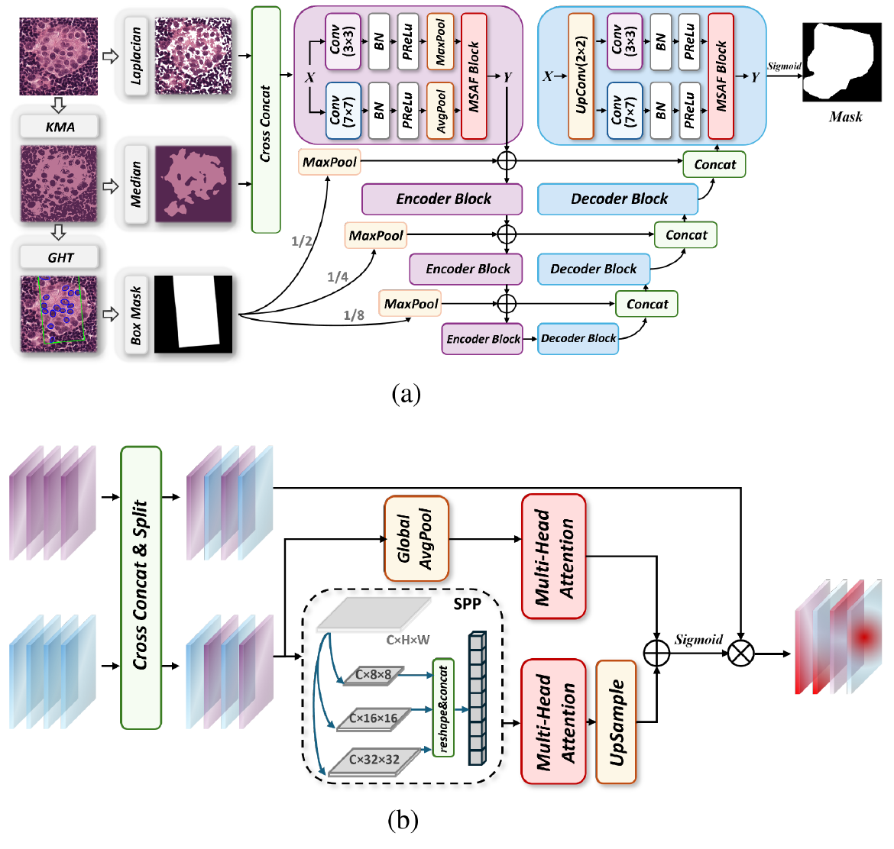
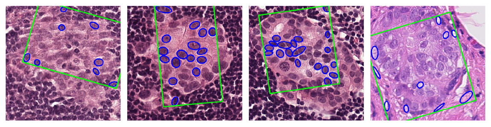
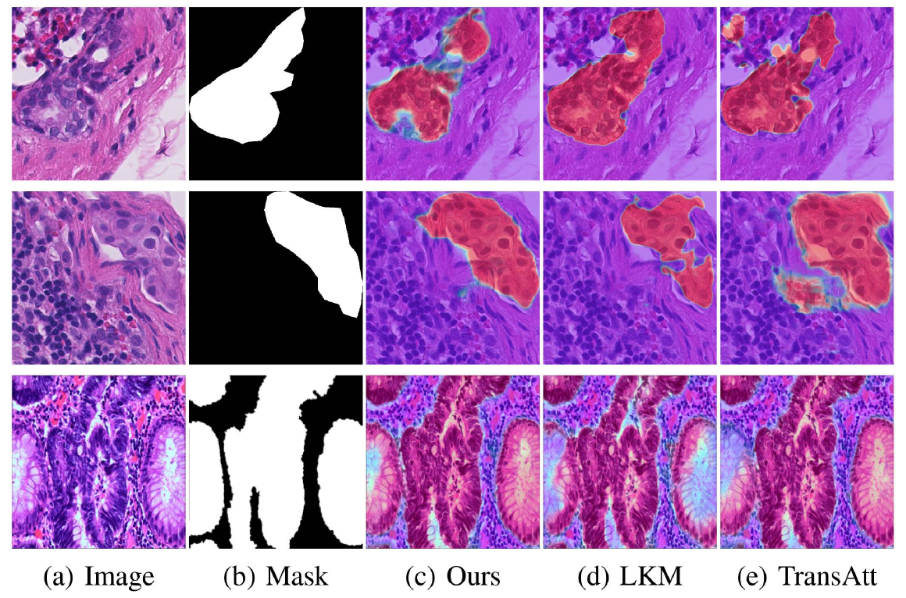
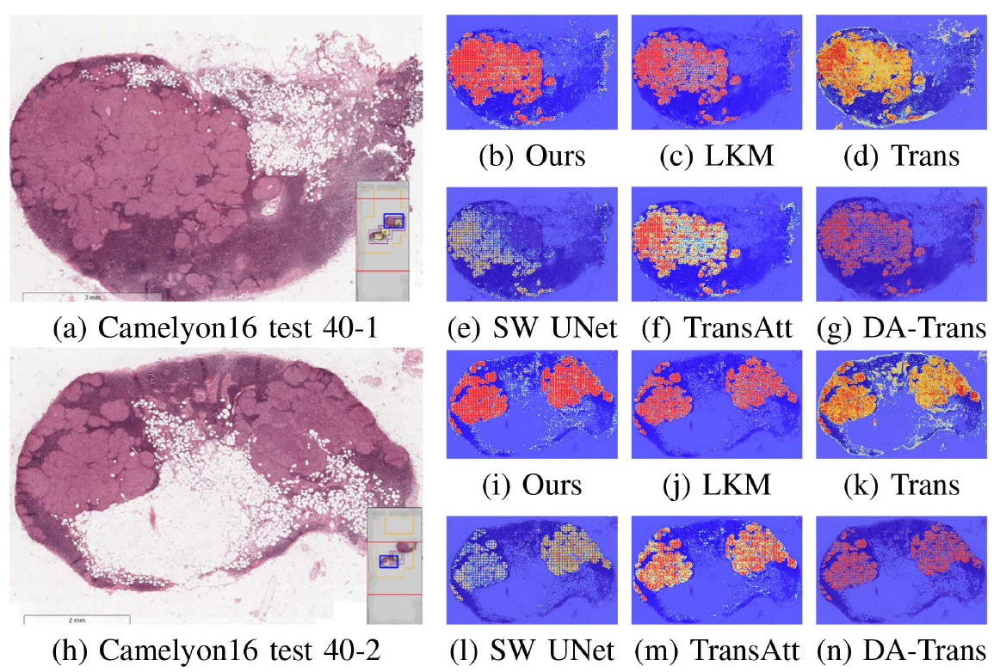
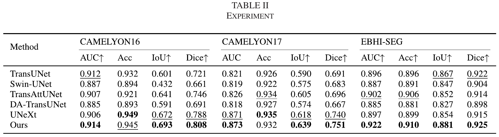
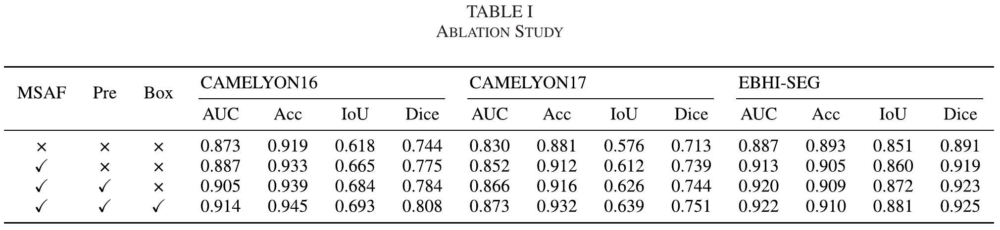

<div align="center">

# MSAF-UNet

### 融合传统图像处理与多尺度注意力的病理图像分割

**CAMELYON16/17 · EBHI-Seg · IEEE Signal Processing Letters 2025**

[项目主页](https://kisen7.github.io/UNet-Camelyon/) · [阅读论文](https://doi.org/10.1109/LSP.2025.3585818) · [English](README.md) · [引用](#引用)

Liqi Ye · Junyou Zhang · Jing Wang · Qi Xi · Yandan Yao<br>
第 32 卷，3415–3419 页，2025 年

</div>

---

**UNet-Camelyon** 汇集病理图像分割代码，以及论文 **MSAF-UNet: A Robust Segmentation Method Integrating Traditional Image Processing and Multi-Scale Attention Fusion** 的研究展示。

## 研究方法

<p align="center"><a href="docs/assets/paper/architecture.png"></a></p>

*论文图 1。点击图片可查看原始尺寸。*

| 模块 | 论文中的作用 |
| --- | --- |
| 纹理与颜色增强 | Laplacian 边缘检测与 Otsu 阈值处理突出纹理；K-means 聚类与中值滤波增强颜色结构。 |
| 并行特征提取 | 3 × 3 与 7 × 7 分支分别捕获局部细节和更大范围的结构。 |
| 多尺度注意力融合 | 通过全局注意力与局部空间金字塔特征整合互补信息。 |
| 框提示 | 通过聚类和广义霍夫变换生成空间信息，并融入跳跃连接。 |

<details>
<summary>框提示原图 · 图 2</summary>



</details>

## 论文结果

下表来自论文 **第 3418 页表 II**；EBHI-Seg 指标为论文所述六类结果的平均值。

| 数据集 | AUC | Accuracy | IoU | Dice |
| --- | ---: | ---: | ---: | ---: |
| CAMELYON16 | 0.914 | 0.945 | 0.693 | **0.808** |
| CAMELYON17 | 0.873 | 0.932 | 0.639 | **0.751** |
| EBHI-Seg | 0.922 | 0.910 | 0.881 | **0.925** |

<p align="center"></p>

*图 3。三行依次来自 CAMELYON16、CAMELYON17 和 EBHI-Seg，图中配色与标注沿用论文原图。*

<details>
<summary>全切片热图 · 图 4</summary>



</details>

<details>
<summary>完整模型对比与消融表格</summary>





</details>

图像直接裁取自已发表论文，保持原始配色、标注和数值。[查看图像来源](docs/assets/paper/SOURCES.md)。

## 项目文件

| 文件或目录 | 作用 |
| --- | --- |
| [`UNet.py`](UNet.py) | PyTorch U-Net 编码器、解码器与跳跃连接 |
| [`train.py`](train.py) | 训练、BCE + Dice 损失、验证与权重保存 |
| [`pre_WSI.py`](pre_WSI.py) | 全切片滑窗推理与热图导出 |
| [`pre_patches.py`](pre_patches.py) | 图像块推理与热图叠加 |
| [`utils/Gen_SegData.ipynb`](utils/Gen_SegData.ipynb) | 从 WSI 和标注生成图像块与掩膜 |
| [`utils/read_data.py`](utils/read_data.py) | 图像与掩膜的配对读取 |
| [`utils/evaluate.py`](utils/evaluate.py) | 分割评估工具 |
| [`skills/`](skills/) | 批量推理、FP16/JIT 选项、ONNX 导出与示例 |
| [`modelArch_output/`](modelArch_output/) | 原有架构说明与可编辑图文件 |
| [`docs/`](docs/) | 中英双语研究页面与论文原图 |

## 使用说明

```bash
git clone https://github.com/Kisen7/UNet-Camelyon.git
cd UNet-Camelyon
python -m venv .venv
```

Linux/macOS 使用 `source .venv/bin/activate` 激活环境；Windows PowerShell 使用 `.venv\Scripts\Activate.ps1`。随后安装依赖：

```bash
python -m pip install -r requirements.txt
```

WSI 读取使用 OpenSlide 及其原生库。训练调用 `segmentation_models_pytorch.utils` API，配置环境时需使用包含该接口的兼容版本。

### 数据与训练

通过 [`utils/Gen_SegData.ipynb`](utils/Gen_SegData.ipynb) 准备图像块。训练读取同名 PNG 图像和掩膜，默认路径为 `/ho/data/Camelyon16/{train,val}/{img,mask}/`。

原有脚本在源码中配置路径和设备。运行前按本机环境核对以下设置：

| 脚本 | 原有设置 |
| --- | --- |
| `train.py` | batch size 为 6；200 epochs；Adam；BCE + Dice；有 CUDA 时使用 `cuda:1`，否则使用 CPU；保存 `UNet_17.pth` |
| `utils/read_data.py` | 数据根目录 `/ho/data/`；图像与掩膜同名配对 |
| `pre_WSI.py` | 输入 `/Camelyon16/test_040.tif`；权重 `UNet.pth`；设备 `cuda:1` |
| `pre_patches.py` | 输入 `patch_path/`；输出 `save_path/`；权重 `UNet.pth`；设备 `cuda:2` |

在仓库根目录启动训练：

```bash
python train.py
```

### 批量推理

原有推理接口支持传入权重路径与设备。准备训练权重及等尺寸图像块目录后，在仓库根目录调用：

```python
from skills.inference_optimized import OptimizedInference

engine = OptimizedInference(
    model_path="UNet_17.pth",
    device="cpu",  # GPU 推理时选择本机对应的 CUDA 设备。
    use_fp16=False,
    use_jit=False,
    batch_size=4,
)
engine.process_patches_directory("patch_path/", "output_path/")
```

## 引用

```bibtex
@article{Ye2025MSAFUNet,
  author = {Ye, Liqi and Zhang, Junyou and Wang, Jing and Xi, Qi and Yao, Yandan},
  title = {{MSAF-UNet}: A Robust Segmentation Method Integrating Traditional Image Processing and Multi-Scale Attention Fusion},
  journal = {IEEE Signal Processing Letters},
  year = {2025},
  volume = {32},
  pages = {3415--3419},
  doi = {10.1109/LSP.2025.3585818}
}
```

本项目保留了 [apple2pig/UNet-Camelyon](https://github.com/apple2pig/UNet-Camelyon) 的原有代码与历史记录，原地址目前跳转到 `aplish064/UNet-Camelyon`。
